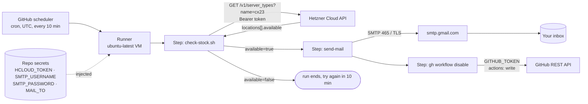

# Hetzner CX23 watcher

A GitHub Actions cron job that asks the Hetzner Cloud API every 10 minutes whether the
**CX23** server type can be ordered, and emails once when it can. Then it switches itself off.

Files:

- [`check-stock.sh`](check-stock.sh) — asks the API, prints the result, writes step outputs
- [`../.github/workflows/hetzner-cx23.yml`](../.github/workflows/hetzner-cx23.yml) — schedule,
  secrets, mail, self-disable. It must live in `.github/workflows/` at the repo root; GitHub reads
  workflows from nowhere else, so this folder holds everything except that one file.

## The problem it solves

The product page <https://www.hetzner.com/cloud/cost-optimized/> shows CX23 as
"not available". Stock comes back without notice, and refreshing a page by hand does not scale.
A Claude Code session cron could do it, but it only runs while a laptop session is open and
expires after 7 days. GitHub Actions runs on GitHub's machines, with nothing running locally.

## Glossary

Every term used below, in plain words.

- **Cron** — a schedule written as five fields: `minute hour day-of-month month day-of-week`.
  `7,17,27,37,47,57 * * * *` means "at minute 7, 17, … of every hour, every day".
- **GitHub Actions** — GitHub's built-in automation. You describe jobs in a YAML file; GitHub
  starts a fresh virtual machine, runs the steps, then throws the machine away.
- **Workflow** — one YAML file in `.github/workflows/`. It says *when* to run (`on:`) and
  *what* to run (`jobs:`).
- **Trigger (`on:`)** — the event that starts a workflow. Here: `schedule` (the cron) and
  `workflow_dispatch` (a "Run workflow" button for manual tests).
- **Job / step** — a job is one machine; steps run on it in order. A step is either a shell
  command (`run:`) or a ready-made action (`uses:`).
- **Runner** — the machine that executes the job. `ubuntu-latest` is a GitHub-hosted Linux VM
  with `curl`, `jq` and `gh` preinstalled. Free for public repositories.
- **Action** — a reusable step someone published, referenced as `owner/repo@version`.
  `actions/checkout@v5` copies the repo onto the runner; `dawidd6/action-send-mail@v23` sends mail.
- **Step output** — a key=value a step writes to the file at `$GITHUB_OUTPUT`. Later steps read
  it as `steps.<id>.outputs.<key>`. This is how "is it available?" travels from the check to the mail.
- **`if:` condition** — a step only runs when its condition is true. Mail and self-disable run
  only when `available == 'true'`.
- **Repo secret** — an encrypted value stored in the repo settings, injected into a step as
  `${{ secrets.NAME }}`. GitHub masks it as `***` in logs. Nobody can read it back, including you.
- **`GITHUB_TOKEN` (`github.token`)** — a short-lived token GitHub creates for every run. The
  `permissions:` block decides what it may do; `actions: write` lets it disable this workflow.
- **REST API** — a web service you call with HTTP: a URL, a method (`GET`), headers, and a JSON
  answer.
- **Hetzner Cloud API** — Hetzner's REST API at `api.hetzner.cloud`. Every call needs an API
  token. `GET /v1/server_types?name=cx23` returns the type and, per location,
  `locations[].available` — `false` while it is temporarily sold out there.
- **Bearer token** — the API token sent as the header `Authorization: Bearer <token>`.
- **Location** — a Hetzner data center site: `nbg1` Nuremberg, `fsn1` Falkenstein,
  `hel1` Helsinki, and others.
- **`curl`** — command-line HTTP client. **`jq`** — command-line JSON filter; it pulls
  `locations[].available` out of the API answer.
- **SMTP** — the protocol mail servers use to accept outgoing mail. The workflow logs in to
  Gmail's SMTP server (`smtp.gmail.com`, port 465, TLS) and hands over one message.
- **TLS** — encryption for the connection, so the password and mail are not sent in clear text.
- **Gmail App Password** — a 16-character password Google generates for one app. It works only
  when 2-Step Verification is on, can be revoked alone, and is what goes into `SMTP_PASSWORD`;
  your real Google password never leaves your head.
- **Concurrency group** — makes sure two runs of this workflow never overlap.

## How it handles it

### Architecture

Five parts, each with one job:

- **GitHub scheduler** — decides *when*. Starts a run on the cron, in UTC.
- **Runner + workflow** — decides *what happens*. One job, four steps.
- **`check-stock.sh`** — the only part that knows Hetzner. Turns an API answer into
  `available=true|false` and `locations=hel1,…`.
- **Gmail SMTP** — delivers the mail. The workflow only hands it over.
- **Self-disable** — stops the watcher after the first mail, so you get one mail, not one
  every 10 minutes.

Why this split: the script can run on your laptop (`FORCE_AVAILABLE=true bash check-stock.sh`)
without GitHub, and the workflow can be tested without Hetzner (the `force_available` button).
Each half is checkable alone.



### Call order

1. GitHub scheduler → starts the `hetzner-cx23` workflow (async, may run minutes late)
2. Runner → `actions/checkout@v5` copies only `hetzner-cron-job/` (sparse checkout)
3. Runner → `check-stock.sh` with `HCLOUD_TOKEN` from secrets
4. `check-stock.sh` → Hetzner Cloud API `GET /v1/server_types?name=cx23` (HTTP, 3 retries)
5. `check-stock.sh` → `jq` picks locations where `available == true` → writes step outputs
6. *If `available == 'true'`:* runner → `dawidd6/action-send-mail` → `smtp.gmail.com:465` → inbox
7. *If `available == 'true'` and not a test run:* runner → `gh workflow disable` → GitHub REST API
8. *Otherwise:* the run ends green, the next one starts on the cron

### What counts as an error

`check-stock.sh` exits with code 1 when it **cannot tell**: API down after retries, wrong
token, or no server type named `cx23` (renamed or retired). The run turns red and GitHub emails a
"Run failed" notice to the account that last edited the cron line. "Not available" is never an
error; it is a green run with no mail.

## Two things to know

- **Schedules are best-effort.** The shortest interval is 5 minutes, runs use UTC, and GitHub
  delays — and under heavy load drops — scheduled runs. Expect "every 10 minutes, sometimes 20".
  Scheduled workflows only run from the default branch (`main`).
- **Public repo, 60-day rule.** This repo is public, so standard runners cost nothing. But GitHub
  disables scheduled workflows in a public repo after **60 days without repository activity**.
  Any commit resets the clock; otherwise re-enable it in the Actions tab.

Workflow logs are public too. Secrets show as `***`; the script never prints the token.

## Alternative: no SMTP

Instead of mailing, the check step could `exit 1` when CX23 is available. GitHub then emails
"Run failed" — no Gmail App Password, no mail secrets. The cost: an outage and real stock look
the same in your inbox, and you only learn which location from the log. Kept as a fallback, not
the default.

## Setup plan

### Phase 1 — Accounts and secrets

- **Phase 1 / Task 1** — Hetzner token. Hetzner Console → your project → Security → API Tokens
  → Generate, permission **Read**. Copy it once.
- **Phase 1 / Task 2** — Gmail App Password. Google Account → Security → turn on 2-Step
  Verification if it is off → App passwords → create one named `hetzner-watcher`. Copy the 16
  characters.
- **Phase 1 / Task 3** — Repo secrets. GitHub → this repo → Settings → Secrets and variables →
  Actions → New repository secret, four times:
  - `HCLOUD_TOKEN` — the token from Phase 1 / Task 1
  - `SMTP_USERNAME` — the Gmail address that sends
  - `SMTP_PASSWORD` — the App Password from Phase 1 / Task 2
  - `MAIL_TO` — the address that receives (can be the same)

  Or with the GitHub CLI, which prompts for each value so it never lands in shell history:

  ```bash
  gh secret set HCLOUD_TOKEN  --repo agenticDraft/cron-jobs-with-git-actions
  gh secret set SMTP_USERNAME --repo agenticDraft/cron-jobs-with-git-actions
  gh secret set SMTP_PASSWORD --repo agenticDraft/cron-jobs-with-git-actions
  gh secret set MAIL_TO       --repo agenticDraft/cron-jobs-with-git-actions
  ```

### Phase 2 — Code (done in this folder)

- **Phase 2 / Task 1** — `check-stock.sh`: API call, `jq` filter, step outputs, test switch.
- **Phase 2 / Task 2** — `.github/workflows/hetzner-cx23.yml`: schedule, manual trigger,
  mail step, self-disable step.
- **Phase 2 / Task 3** — Merge the pull request into `main`. Scheduled runs start only from the
  default branch.

### Phase 3 — Verification

- **Phase 3 / Task 1** — Local script check (no token needed):

  ```bash
  bash -n hetzner-cron-job/check-stock.sh && FORCE_AVAILABLE=true bash hetzner-cron-job/check-stock.sh
  # expect: available=true, locations=TEST
  ```

- **Phase 3 / Task 2** — Real API, normal path. After the merge:

  ```bash
  gh workflow run hetzner-cx23 --repo agenticDraft/cron-jobs-with-git-actions
  gh run watch --repo agenticDraft/cron-jobs-with-git-actions
  ```

  Expect a green run whose "Check CX23 stock" log shows
  `cx23: offered in [...], available in [...]`. While sold out: no mail, workflow stays enabled.

- **Phase 3 / Task 3** — Mail path. Run with the test switch:

  ```bash
  gh workflow run hetzner-cx23 -f force_available=true --repo agenticDraft/cron-jobs-with-git-actions
  ```

  Expect a mail "Hetzner CX23 is available (TEST)" in the `MAIL_TO` inbox, and the workflow still
  enabled (`gh workflow list` shows it `active`).

- **Phase 3 / Task 4** — Schedule is live. About 30 minutes after the merge:

  ```bash
  gh run list --workflow hetzner-cx23 --event schedule --repo agenticDraft/cron-jobs-with-git-actions
  ```

  At least one scheduled run listed, all green. This is the check that proves the watcher works.
